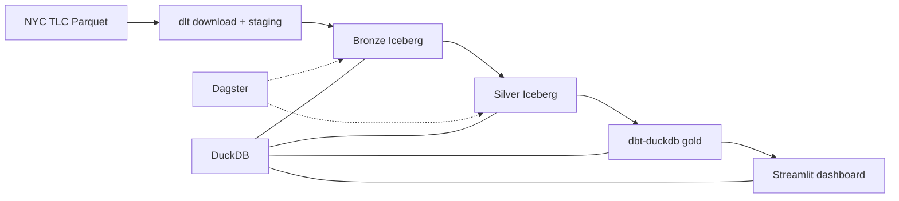

# Architecture — NYC Taxi Lakehouse Lite

Interview-oriented overview of how data flows through this repo, why each tool is here, and how the pipeline stays correct on re-runs.

**Related:** [`ROADMAP.md`](ROADMAP.md) · [`PLAN.md`](PLAN.md) · [`phase5-tuning.md`](phase5-tuning.md)

## Problem and constraints

- **Domain:** NYC TLC yellow taxi trip Parquet (monthly files on CloudFront).
- **Goal:** A **medallion lakehouse** that demonstrates senior data-engineering patterns without a cluster or Docker.
- **Runtime:** Windows-friendly, ~16GB RAM — **DuckDB + Polars** on disk, not Spark (optional Phase 7 adds cloud Spark).

## High-level flow

| Layer | Storage | Code | Responsibility |
|-------|---------|------|----------------|
| Bronze | `lake/bronze/yellow_taxi_trips` | `ingestion/bronze_yellow.py`, `ingestion/tlc_yellow_dlt.py` | Land raw TLC columns + lineage (`trip_month`, `_loaded_at`, `_source_file`) |
| Silver | `lake/silver/yellow_taxi_trips` | `transforms/silver_yellow.py`, `transforms/yellow_taxi_clean.py` | Rename, business rules, **pandera** contract |
| Gold | DuckDB tables via dbt | `dbt/models/gold/*` | Star schema: `fact_trips`, `dim_zone`, `dim_date` |
| Serving | Read-only DuckDB | `serving/queries.py`, `serving/app.py` | Streamlit on gold marts |

## Catalog and paths

- **Warehouse:** gitignored `./lake/` (override with `LAKEHOUSE_ROOT`).
- **Iceberg catalog:** SQLite file (`lake/catalog.db`) via **pyiceberg** SQL catalog.
- **Namespaces:** `bronze.*`, `silver.*`.
- **Config:** `lakehouse.config.LakehouseConfig` + `config/profiles/local.yaml` (and optional `cloud`).

DuckDB reads Iceberg through metadata paths and optional views (`lakehouse/duckdb_views.py`).

## Partitioning and incremental model

- **Partition key:** `trip_month` (`YYYY-MM`), **identity** partition on bronze and silver.
- **Dagster:** `MonthlyPartitionsDefinition` from `2024-01` through `2025-12`; partition key equals Iceberg `trip_month`.
- **Idempotency per month:** before loading a month, the pipeline **deletes** that partition, then **appends** fresh data. Re-running January does not double January rows.

Bronze (`ingestion/bronze_yellow.py`):

1. Download month Parquet to `lake/staging/tlc/yellow/` (dlt helpers + `requests`).
2. `table.delete(EqualTo("trip_month", month))`.
3. Stream Arrow batches through `append_batches` (see tuning).

Silver (`transforms/silver_yellow.py`):

1. `bronze.scan(row_filter=EqualTo("trip_month", month))`.
2. Polars clean + pandera validate.
3. `table.delete(EqualTo("trip_month", month))` then `append` aligned Arrow.

Empty bronze for a month clears silver for that month.

## Data quality

| Stage | Mechanism | Examples |
|-------|-----------|----------|
| Silver | pandera (`transforms/schemas/yellow_taxi_silver.py`) | Types, required fields |
| Silver | Polars filters in `clean_yellow_taxi_bronze` | Dropoff ≥ pickup, zone IDs 1–263, fare/trip bounds |
| Gold | dbt tests | Uniqueness, relationships, not-null on keys |
| Ops | Re-run same month | Partition replace, not append-only duplication |

**Schema evolution (silver):** older tables may lack `pickup_date` and `_silver_version`; `evolve_silver_yellow_table` adds them via Iceberg schema updates.

## Orchestration

**Dagster** (`orchestration/definitions.py`):

- `lakehouse_bootstrap` — directories + catalog namespaces.
- `bronze_yellow_taxi` / `silver_yellow_taxi` — partitioned assets calling `run_bronze_yellow_ingest` and `run_silver_yellow_transform`.

CLI mirrors assets: `make ingest-yellow`, `make silver-yellow`, `make dbt-gold`, `make dashboard`.

Backfill: materialize Dagster partitions, or set `TLC_YELLOW_START` / `TLC_YELLOW_END` (see `ingestion/README.md`).

## Performance (Phase 5)

Yellow months are ~3M rows. Default Iceberg write targets split months into many small files. This project sets **`write.target-file-size-bytes` to 2 GiB** (uncompressed Arrow budget) and buffers bronze batches so a month tends to land as **one Parquet file per `trip_month`**. `make tune` compacts any month that still has multiple files and prints DuckDB `EXPLAIN ANALYZE` — details in [`phase5-tuning.md`](phase5-tuning.md).

## Gold and serving

- dbt builds into DuckDB (`make dbt-gold`): seed zones, staging from silver, gold star schema, tests, docs.
- Streamlit (`serving/app.py`) opens a **read-only** DuckDB connection and runs SQL in `serving/queries.py` against `main_gold.*`.

## Design decisions (talking points)

| Choice | Why here | Alternative |
|--------|----------|-------------|
| Iceberg + pyiceberg | Open table format, partition evolution, local SQLite catalog | Delta-rs, Hive |
| DuckDB engine | Fast local analytics, Iceberg scan, dbt-duckdb | Spark, Trino |
| Dagster | Asset lineage, partitions, light RAM | Airflow (heavier lab in sibling repo) |
| dlt | Staging/download pattern for TLC files | Custom scripts only |
| No Docker | Laptop-friendly learning repo | `nyc-taxi-lakehouse` full stack |
| Month replace | Simple correctness for monthly TLC drops | MERGE / CDC |

## Failure modes and operations

- **Re-ingest a bad month:** Run bronze (and silver) for that partition only; replace semantics overwrite the month.
- **Partial download:** Staging file size check + re-download with `force` where supported.
- **Silver rejects rows:** `clean_yellow_taxi_bronze` stats (`rejected_rows`); output row count ≤ bronze for that month.
- **Gold out of date:** Re-run `dbt-gold` after silver changes.

## What CI guards

GitHub Actions runs `ruff` and `pytest` (no TLC download). Tests cover catalog bootstrap, silver cleaning, **bronze/silver month replace**, dbt gold on fixtures, Dagster partition defs, tuning helpers, and serving SQL. See `tests/test_bronze_month_replace.py` and `tests/test_silver_month_replace.py`.

## Optional Phase 7 (cloud)

Not required for the core story: object storage for `lake/`, one distributed Spark exercise on a free tier. Local architecture above stays the same; only warehouse URI and compute scale change.
